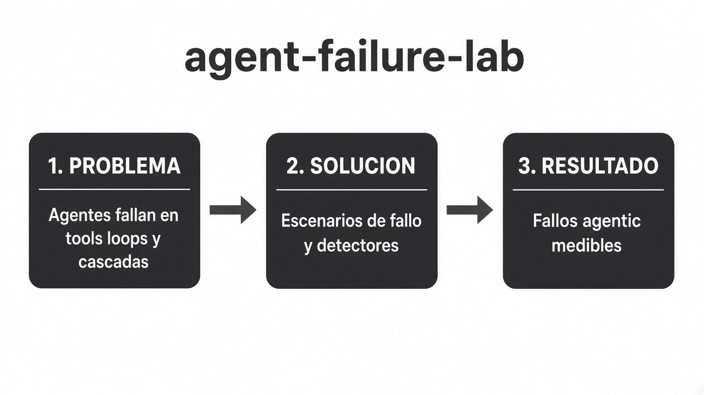
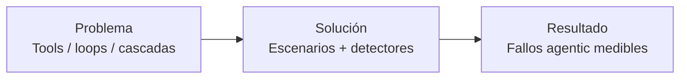

<div align="center">

# agent-failure-lab

**Fallos agentic detectables** · Angel Salazar

<br/>


</div>

---

### `$ cat diagrama.md`



---

### `$ cat problema.md`

Los agentes fallan en tools, loops de coste y alucinaciones en cadena.  
Este lab fuerza esos escenarios y comprueba que se detectan.

Basado en taxonomías agentic RAG (F26–F31).

---

```bash
pip install -e .
pytest
python -m agent_failure
```

---

Hecho en Lima · Angel Salazar · CIP 404730
